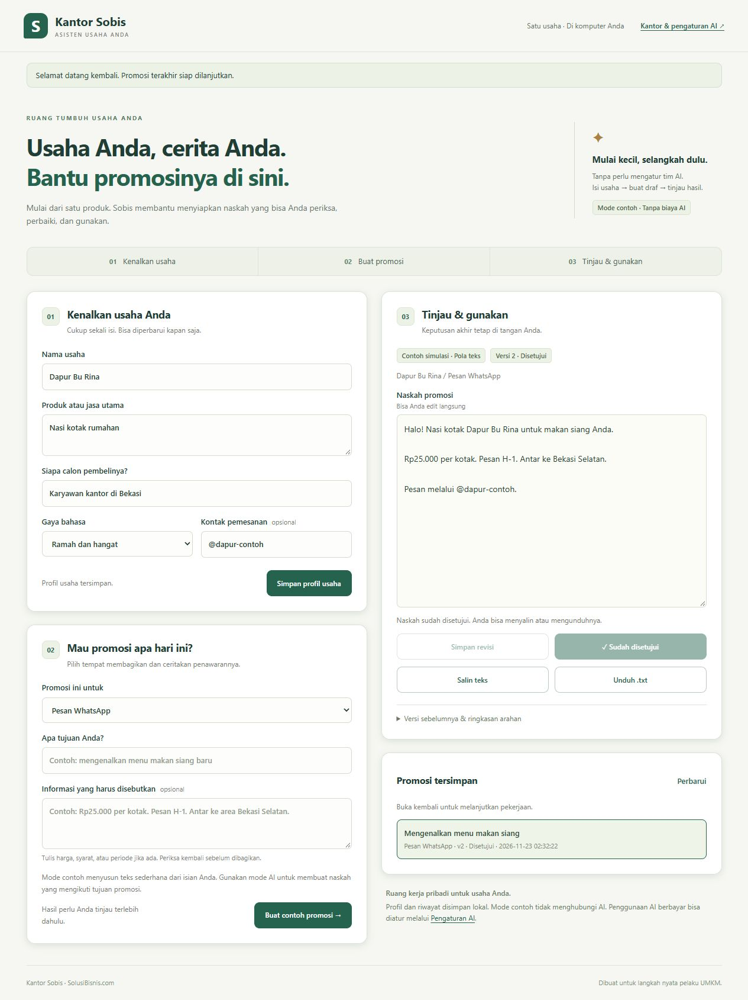

# Kantor Sobis — Asisten usaha untuk UMKM

Buat naskah promosi dari informasi usaha Anda, periksa hasilnya, lalu salin atau unduh untuk digunakan. Kantor Sobis berbahasa Indonesia dan berjalan di komputer sendiri: **satu instalasi untuk satu usaha, tanpa membuat akun pelanggan**.

**Versi 1.2.0 · Aplikasi lokal SolusiBisnis.com · Portofolio pengembangan produk untuk UMKM**



## Mulai di Windows

1. Pasang **Python 3.12 atau lebih baru** dari [situs resmi Python](https://www.python.org/downloads/windows/). Aktifkan pilihan **Add Python to PATH** saat pemasangan.
2. Di halaman repositori ini, pilih **Code → Download ZIP**, kemudian ekstrak ZIP ke folder di komputer. Buka folder yang berisi `install.bat`.
3. Klik dua kali **`install.bat`**. Persiapan pertama memerlukan internet untuk mengunduh paket Python. Tunggu sampai muncul pesan selesai.
4. Klik dua kali **`run.bat`**. Browser membuka [ruang usaha Anda](http://127.0.0.1:8765) setelah aplikasi siap.

Untuk pemakaian berikutnya cukup buka `run.bat`. Biarkan jendela server terbuka; tekan **Ctrl+C** untuk berhenti. Mode awal adalah **contoh simulasi**, sehingga Anda bisa mencoba tanpa kunci API atau biaya AI.

Jika Python baru dipasang tetapi belum ditemukan, tutup jendela pemasangan lalu coba kembali. Jika port dipakai versi aplikasi lama, hentikan server lama terlebih dahulu. Launcher tidak menghentikan program lain.

## Promosi pertama dalam tiga langkah

1. **Kenalkan usaha.** Isi nama, produk/jasa, calon pembeli, gaya bahasa, dan kontak opsional. Klik **Simpan profil usaha**.
2. **Buat promosi.** Pilih WhatsApp, Instagram, atau deskripsi produk toko online. Tulis tujuan dan fakta seperti harga, wilayah layanan, atau periode penawaran.
3. **Tinjau dan gunakan.** Periksa naskah. Jika diubah, klik **Simpan revisi**, lalu **Setujui naskah**. Tombol **Salin teks** dan **Unduh .txt** aktif setelah persetujuan.

Contoh latihan: usaha *Dapur Bu Rina*, produk *nasi kotak rumahan*, calon pembeli *karyawan di Bekasi*, informasi *Rp25.000 per kotak, pesan H-1*. Semua data pada tangkapan layar adalah data contoh.

Promosi tersimpan dapat dibuka kembali. Revisi membuat versi baru dan meminta persetujuan ulang. Versi terdahulu tetap dapat dibaca. Perubahan profil usaha berlaku untuk promosi baru, sementara promosi lama menyimpan profil saat dibuat.

## Mode contoh dan AI

| Mode | Cara kerja |
|---|---|
| **Contoh simulasi** | Menyusun pola teks sederhana dari isian Anda. Tidak memanggil AI, tidak memerlukan akun penyedia, dan tidak menalar tujuan promosi. Hasil selalu diberi label contoh. |
| **AI / Live** | Mengirim profil usaha dan arahan promosi ke OpenRouter dengan kunci API milik Anda. Membutuhkan internet, model yang tersedia, saldo penyedia, dan persetujuan biaya. |

Untuk mengaktifkan AI, buka **Kantor & pengaturan AI → Setelan**. Isi kunci OpenRouter sendiri, simpan, pilih Live, dan konfirmasi penggunaan berbayar. Menyimpan kunci saja tidak mengaktifkan AI. Kembali ke beranda usaha melalui **Kembali ke usaha saya**, lalu tekan **Perbarui** jika mode belum berubah. Setiap pembuatan promosi dalam mode Live juga meminta persetujuan biaya.

Daftar model memakai snapshot manual dari [endpoint resmi OpenRouter](https://openrouter.ai/api/v1/models), diperiksa pada 23 November 2026. Ketersediaan dan tarif dapat berubah; Anda bisa memasukkan ID model sendiri. Mode Live telah diuji dengan transport sintetis, **belum dengan panggilan berbayar sungguhan**. Pemakaian tercatat di menu **Pemakaian**, dengan biaya tercatat, estimasi, dan biaya belum diketahui dipisahkan. Permintaan gagal pun mungkin dikenakan biaya oleh penyedia.

Jika server dijalankan dengan `LLM_MODE=mock`, Live dikunci sampai server dihentikan dan variabel tersebut dihapus. Mode contoh tetap tersedia tanpa jaringan setelah dependensi terpasang.

## Data Anda

- Profil, promosi, versi naskah, percakapan, dan pemakaian disimpan dalam SQLite di `data/kantor_sobis.db`.
- Kunci API yang diisi melalui Setelan disimpan di database lokal dan **belum dienkripsi sebagai vault**. Jangan membagikan database, `.env`, atau cadangan privat.
- Untuk mencadangkan, **hentikan aplikasi terlebih dahulu**, kemudian salin seluruh folder `data` ke tempat privat. Untuk memulihkan, hentikan aplikasi dan kembalikan folder cadangan dari versi yang cocok.
- Aplikasi mendengarkan `127.0.0.1` secara default. Aplikasi ini ditujukan untuk komputer pribadi dan belum untuk akses internet publik.

GitHub publik membagikan kode aplikasi. Setiap orang menjalankan salinannya sendiri. Tidak ada pendaftaran pelanggan, langganan, atau konsol pengelola pelanggan pada versi ini.

## Fitur tambahan

[Konsol kantor](http://127.0.0.1:8765/kantor) tetap menyediakan kantor virtual, tim agen, chat, papan tugas, usulan memori, dan rincian pemakaian. Fitur ini opsional untuk pengguna yang ingin mengatur pekerjaan lebih jauh. Promosi pada beranda memiliki riwayat sendiri; tidak otomatis menjadi tugas pada papan agen.

Versi awal konsol dapat dilihat di [tangkapan layar v1.1](docs/tampilan-v1.1.png). Catatan rilis tersedia di [CHANGELOG.md](CHANGELOG.md).

## Untuk pengembang

FastAPI, SQLite, JavaScript tanpa proses build, dan Server-Sent Events pada konsol agen. Beranda usaha menggunakan endpoint `/api/business`, profil lokal tunggal, serta versi naskah yang disimpan secara transaksional.

```powershell
python -m venv .venv
.\.venv\Scripts\python.exe -m pip install -r requirements.txt
$env:LLM_MODE = 'mock'
.\.venv\Scripts\python.exe launcher.py
```

Tes backend memakai database sementara dan memblokir transport jaringan pada kontrak yang relevan. Tes Live menggunakan kredensial sintetis, tanpa panggilan AI berbayar. Node.js diperlukan untuk tes konsol.

```powershell
.\.venv\Scripts\python.exe -m unittest discover -s tests -p 'test_*.py'
.\.venv\Scripts\python.exe tests\check.py
node --test tests/test_ui_contract.js tests/test_office.js
```

## Batas versi ini

Fokus pertama adalah promosi teks. Aplikasi belum membuat gambar/video, mengirim WhatsApp, atau menerbitkan posting secara otomatis. Salin atau unduh hasil, lalu bagikan sendiri setelah diperiksa. Mode contoh hanya membantu mencoba alur; mutu naskah AI bergantung pada model dan isian pengguna.
