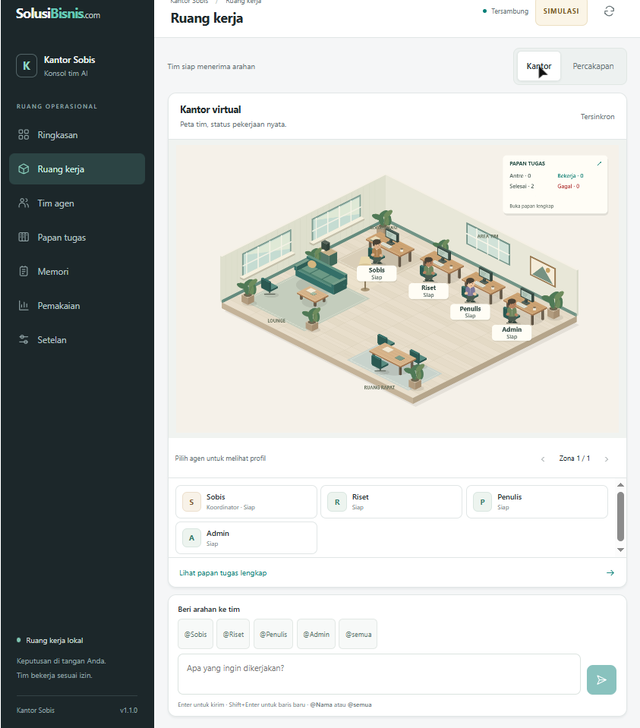

# Kantor Sobis

Kantor Sobis adalah aplikasi lokal berbahasa Indonesia untuk memberi arahan kepada tim agen AI dan memantau pekerjaan mereka. Pengguna memberi tugas kepada Sobis, yang dapat membaginya kepada spesialis seperti Riset, Penulis, dan Admin, lalu merangkum hasilnya. Papan tugas menunjukkan kemajuan dan hasil setiap pekerjaan.

**Versi 1.1.0 · prototipe lokal SolusiBisnis.com**



## Yang bisa dicoba

- Beri arahan ke Sobis atau pilih agen langsung, misalnya `@Penulis`.
- Pantau tugas yang mengantre, dikerjakan, selesai, atau gagal.
- Tinjau usulan memori sebelum digunakan oleh tim.
- Lihat status agen di kantor virtual serta rincian pemakaian simulasi dan mode live.

## Jalankan demo di Windows

Gunakan Python 3.12. Jalankan perintah berikut di PowerShell dari folder proyek.

```powershell
python -m venv .venv
.\.venv\Scripts\python.exe -m pip install -r requirements.txt
$env:LLM_MODE = 'mock'
$env:HOST = '127.0.0.1'
.\.venv\Scripts\python.exe launcher.py
```

Launcher membuka [Kantor Sobis di browser](http://127.0.0.1:8765) setelah server siap. Buka **Ruang kerja**, kirim `Sobis, bagi tugas: buat rencana konten minggu depan untuk kedai kopi`, lalu lihat hasil di **Papan tugas**. Tekan `Ctrl+C` di PowerShell untuk menghentikan server.

Mode simulasi memakai balasan contoh untuk memperagakan alur kerja tanpa akun, kunci API, atau biaya model. Mode live adalah opsi untuk pemakaian lokal dengan kunci OpenRouter milik pengguna dan konfirmasi biaya. Prototipe ini belum memiliki login atau pemisahan data antar pengguna. Jalankan demo pada `127.0.0.1`.

## Cara kerja

FastAPI menerima arahan dan memasukkannya ke antrean kerja. Sobis dapat mendelegasikan tugas kepada spesialis. SQLite menyimpan percakapan, status, hasil tugas, dan usulan memori. Antarmuka JavaScript menampilkan pembaruan pekerjaan melalui Server-Sent Events (SSE).

## Pemeriksaan lokal

Tes menggunakan database sementara dan tidak memanggil API berbayar. Tes antarmuka memerlukan Node.js.

```powershell
.\.venv\Scripts\python.exe -m unittest discover -s tests -p 'test_*.py'
.\.venv\Scripts\python.exe tests\check.py
node --test tests/test_ui_contract.js tests/test_office.js
```

## Rencana pengembangan

Prioritas berikutnya adalah alur terpandu untuk pekerjaan UMKM, dimulai dari pembuatan materi promosi. Pengguna akan mengisi ringkasan bisnis, meninjau draf, lalu merevisi atau mengunduh hasilnya. Uji coba dengan pelanggan memerlukan akun, pemisahan data, dan batas pemakaian.
